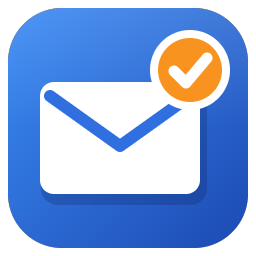
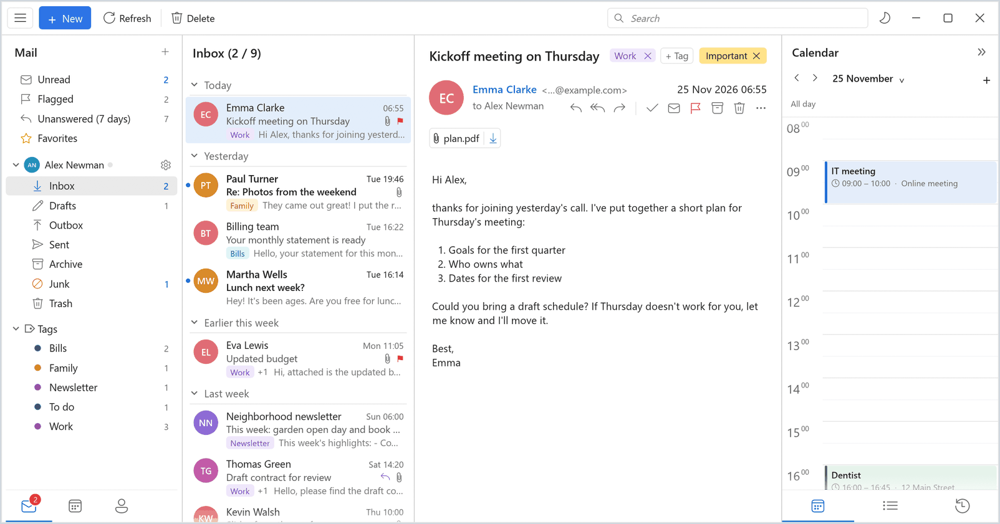
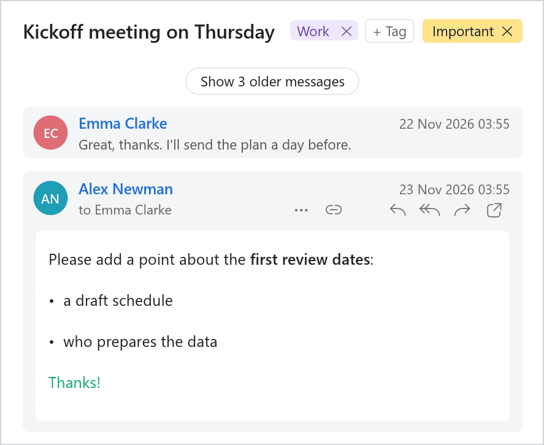
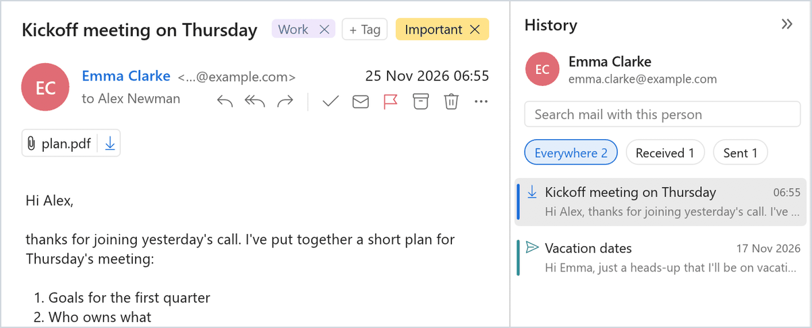
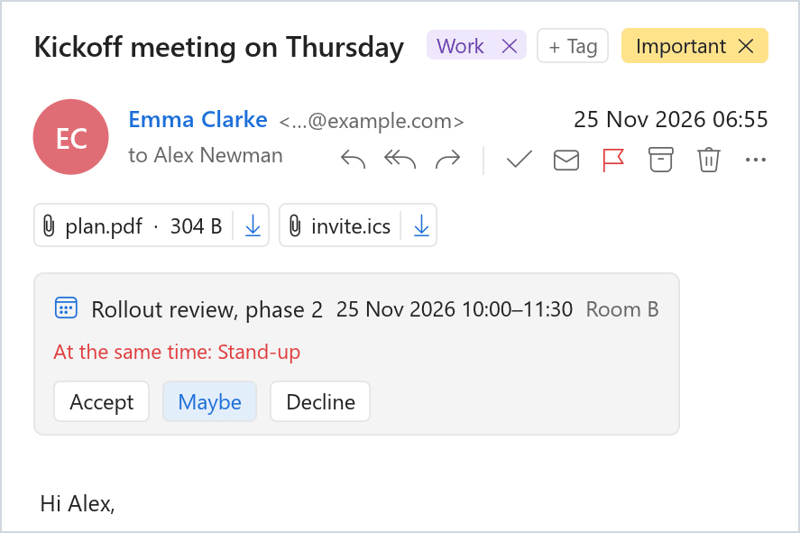
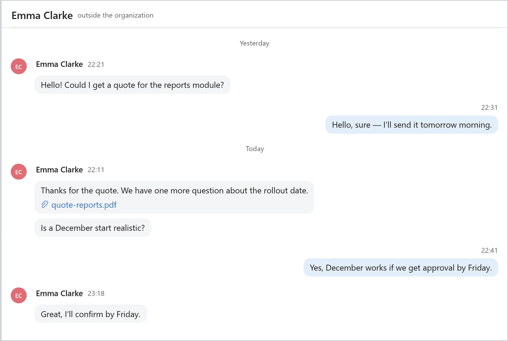
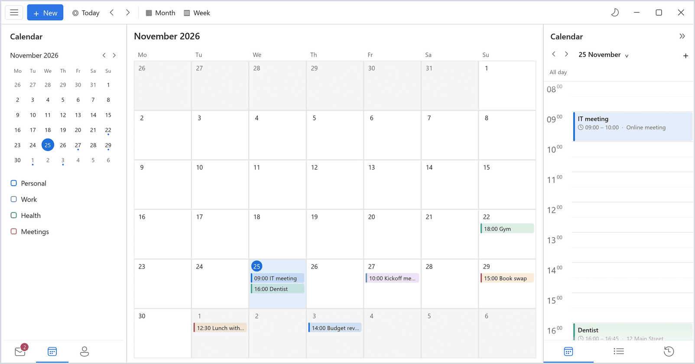
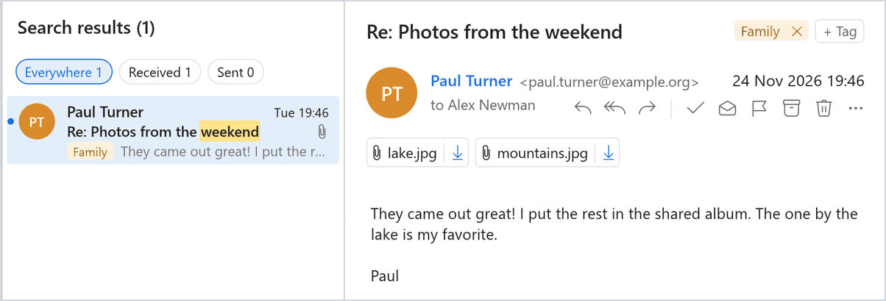

<div align="center">

<b>English</b> | <a href="README.pl.md">Polski</a>



# Poczta

**Mail, calendar and contacts in one fast, native Windows app.**

For Gmail and IMAP mailboxes, with Google Calendar built in.<br>
**Your mail syncs straight between your provider and your PC, with no server of ours in between.** No ads, no subscription. Free and open source.

<a href="https://github.com/jarx-dev/MailsRust/releases/latest"></a>

<sub>Windows 10 and 11 · portable ~34 MB EXE · not code-signed · [first-run guide](#download-and-first-run)</sub>

[](https://github.com/jarx-dev/MailsRust/releases/latest)
[](https://github.com/jarx-dev/MailsRust/releases/latest)
[](https://github.com/jarx-dev/MailsRust/actions/workflows/ci.yml)
[](LICENSE)

[Poczta vs Outlook](#poczta-and-the-new-outlook) · [Features](#what-you-get) · [Download](#download-and-first-run) · [Performance](#performance) · [Privacy](#privacy-at-a-glance) · [For developers](#for-developers)

<picture>
  <source media="(prefers-color-scheme: dark)" srcset="docs/screenshots/en/dark.png">
  
</picture>

<sub>All screenshots show made-up demo data. "Poczta" is Polish for "Mail"; the app speaks English and Polish.</sub>

</div>

## Poczta and the new Outlook

Thinking of leaving the new Outlook for Windows? Here is what changes. Every statement about how
Outlook works links to Microsoft's own documentation.

| | **Poczta** | **New Outlook for Windows** |
|---|---|---|
| **Accounts** | Gmail and IMAP/SMTP mailboxes. Not yet: Microsoft sign-in for Outlook.com, Microsoft 365 and Exchange | Outlook.com, Microsoft 365, Exchange, Gmail, Yahoo, iCloud and more ([Microsoft](https://support.microsoft.com/en-us/outlook/getstarted/add-an-email-account-to-outlook-for-windows)) |
| **Where a copy of your Gmail goes** | To your PC | For many features, also to the Microsoft Cloud: mail, calendar and contacts ([Microsoft](https://support.microsoft.com/en-us/outlook/getstarted/sync-your-account-in-outlook-to-the-microsoft-cloud)) |
| **Ads** | None, and no ad IDs | With a free personal account it shows ads in the inbox and passes a cookie or device ID to ad networks; removing them takes a Microsoft 365 subscription ([Microsoft](https://support.microsoft.com/en-us/outlook/about-ads-in-outlook)) |
| **Price** | Free, MIT licence | Free with ads, or a Microsoft 365 subscription ([Microsoft](https://support.microsoft.com/en-us/outlook/about-ads-in-outlook)) |

Poczta does not have Microsoft's own sign-in yet, which Outlook.com, Microsoft 365 and Exchange accounts
need; such a mailbox works only through IMAP, where its server allows that. There is no version for macOS, Linux or phones.

## What you get

**Fast, even with a big mailbox.** The mailbox is read from disk in about 60 ms, a 78,000-message
mailbox is on screen in under a second, and at rest Poczta measured 0.0–0.8% of one CPU core, so it stays
quiet in the background. Syncing and indexing run in background threads, so scrolling and reading do not
wait for the network ([measurements](#performance)).

### Conversations and history
Never lose the thread of who said what.
- **Conversations in one place:** the open message expanded, earlier ones folded into cards.
- **History** next to any message: the mail that person sent you and the mail you sent straight to them, one click away.
- **New mail as soon as the server signals it** (IMAP IDLE), with a sound, a counter on the icon
  and a notification, also when Poczta sits in the tray.
- **Your way of sorting:** Unread, Flagged and "Unanswered (7 days)" views, and in Gmail also labels,
  favorites and your own folders, with messages dragged onto a folder or tag. Gmail filters can be created and edited in the app.
- Several accounts at once: the main one with Google sign-in or a password, further ones with a password
  (for Gmail, an app password).

<table>
<tr>
<td width="50%" valign="top"><picture><source media="(prefers-color-scheme: dark)" srcset="docs/screenshots/en/thread-dark.png"></picture></td>
<td width="50%" valign="top"><picture><source media="(prefers-color-scheme: dark)" srcset="docs/screenshots/en/history-dark.png"></picture></td>
</tr>
<tr>
<td align="center"><sub>A conversation, earlier messages folded</sub></td>
<td align="center"><sub>History: your mail with this person</sub></td>
</tr>
</table>

### Writing that keeps up
Format as you type, without reaching for a toolbar.
- **Markdown as you type:** `**bold**`, `*italic*`, `` `code` ``, lists and headings turn into
  formatting on the spot, and the message goes out as ordinary HTML.
- **@mentions:** type **@** and a name to pick someone from your address book; they are added to "To".
- Images in the text, and a signature picked up from the mail you have already sent.

### Invitations, calendar and Google Chat
Your day next to your mail, so you answer invitations knowing what clashes.
- **Invitations** get Accept · Maybe · Decline right above the message, with a note of what clashes in
  your calendar. A reminder pops up 10 minutes before each meeting with a set time.
- **Calendar** in month and week views, plus a day panel next to your mail, synced with Google Calendar
  both ways.
- **Google Chat** for Google Workspace accounts, in the same window.
- **Contacts** with groups, including the people you exchange mail with.

<table>
<tr>
<td width="50%" valign="top"><picture><source media="(prefers-color-scheme: dark)" srcset="docs/screenshots/en/invite-dark.png"></picture></td>
<td width="50%" valign="top"><picture><source media="(prefers-color-scheme: dark)" srcset="docs/screenshots/en/chat-dark.png"></picture></td>
</tr>
<tr>
<td align="center"><sub>Answer an invitation, see what clashes</sub></td>
<td align="center"><sub>Google Chat in the same window</sub></td>
</tr>
</table>

<picture>
  <source media="(prefers-color-scheme: dark)" srcset="docs/screenshots/en/calendar-dark.png">
  
</picture>

### Find anything
- **Word search** from an index built in the background: newest first, the searched word highlighted.
- **Search by meaning:** a multilingual model runs on your PC and finds messages about
  the same thing, even when they use different words. The model (about 500 MB) is downloaded once, on the
  first start with a mail account; after that this search works offline and never sends your mail or
  your searches anywhere.

<picture>
  <source media="(prefers-color-scheme: dark)" srcset="docs/screenshots/en/search-dark.png">
  
</picture>

### Safe by default
- Messages never run their own scripts, and a link that shows one address but opens another is marked.
- A warning appears above a message that looks like phishing. These checks run on your PC; an AI second
  opinion is one click away when you have set up AI.

### AI on your terms (optional)
- **Fix with AI** in several styles, and **translation** of received mail into your language.
- Works with any API compatible with the Anthropic Messages API (`/v1/messages`), with your own address
  and key (☰ menu → "AI settings"). These features stay off until you enter them, and run only when you click.

### Looks right
Light and dark themes, one icon set (Segoe Fluent), English or Polish (☰ menu → "Language / Język",
switches at once), and the classic layout: folders | list | message | calendar day.

## Download and first run

<a href="https://github.com/jarx-dev/MailsRust/releases/latest"></a>

1. **Download** `Poczta-….exe` from the **Assets** list on the [release page](https://github.com/jarx-dev/MailsRust/releases/latest)
   (the button opens that page).
2. **Check it, if you like.** The file is not code-signed, but every GitHub release is built by GitHub Actions from
   this repository with a provenance attestation: `gh attestation verify Poczta-….exe -R jarx-dev/MailsRust`.
3. **Run it.** There is nothing to install. Windows SmartScreen may warn about an unknown publisher:
   "More info" → "Run anyway".
4. **Add your account**: Gmail with Google sign-in, or an IMAP/SMTP mailbox. The first Google sign-in
   needs a one-time setup of your own Google Cloud project (about 5 minutes, the app walks you through
   it); a Gmail app password over IMAP skips it. Your mail stays on the
   server as before; Poczta keeps its own copy in `%LOCALAPPDATA%\Poczta`. On this first start it also
   downloads the search-by-meaning model once (about 500 MB).

New releases are downloaded by the app itself, checked against their SHA-256 and rolled back if the new
version does not start.

## Getting help

Trouble starting Poczta or adding an account, or a feature you miss?
[Open an issue](https://github.com/jarx-dev/MailsRust/issues) and describe what you see.

## Performance

Measured on a laptop with an NVMe disk and a real mailbox of 78,507 messages (a ~530 MB database).
Times are counted from the moment the window opens.

| What | Result |
|---|---|
| Opening the database | 1–3 ms |
| Message list read from disk | 50–63 ms |
| First frame with the whole mailbox | 0.7–0.8 s |
| CPU at rest | 0.0–0.8% of one core |
| Memory at rest, with this mailbox and its search index loaded | 385–392 MB |
| Program | one EXE file, ~34 MB |

Details and how it was measured: [PERF.md](PERF.md).

## Privacy at a glance

**Your mail never passes through a server of ours: Poczta syncs with your mail provider directly.
Mail goes to an AI service only when you set one up and click an AI feature, or switch on AI agents (below).**

- Your copy of the mail stays on your PC: a database and a cache folder in `%LOCALAPPDATA%\Poczta`. Passwords are encrypted with your Windows account key (DPAPI).
- No analytics and no tracking by Poczta. Everything Poczta connects to:
  - your mail server, and Google for sign-in, Gmail, Calendar, Contacts and Chat;
  - the servers that host pictures and styles inside a message you open (Poczta opens the newest one
    at start), so, as in most mail apps, a sender can tell it was opened;
  - addresses you add yourself: iCal calendars and an autoresponder link;
  - Google's public site-icon service, for the logos of companies that write to you (it sees their domain);
  - Hugging Face, once, to download the search-by-meaning model;
  - GitHub, to check for and download new releases;
  - errors.jarx.pl, to send a short crash report you can switch off ([exactly what it contains](#crash-reports));
  - the AI service you set up yourself, if any: only what the feature you click needs, such as the text
    to fix or translate, or for a phishing check the sender, headers, links and attachment names.

## Crash reports

When the app hits a Rust panic, it sends one short anonymous report so the bug can be found and
fixed. Only the first panic of a run is reported, also one the app recovers from (some background
jobs catch panics and go on). It is on by default; turn it off in the ☰ menu: **Send crash reports**.
The change takes effect at once. Builds made with `cargo build` in debug mode never send anything.

This is the whole report, the three lines of a Sentry envelope:

```
{"event_id":"4f0c1d0e9a2b4c7d8e6f5a4b3c2d1e0f"}
{"type":"event"}
{"event_id":"4f0c1d0e9a2b4c7d8e6f5a4b3c2d1e0f","level":"fatal","platform":"native","release":"poczta@26.1104.2135","environment":"production","contexts":{"os":{"name":"Windows","version":"10.0.26100"}},"exception":{"values":[{"type":"panic","value":"src/app/list.rs:123","mechanism":{"type":"panic","handled":false}}]},"fingerprint":["src/app/list.rs:123"]}
```

That is: the build number (when the app was built, in UTC), the Windows version, and the place in
the source code where it crashed. `event_id` is a random number for this one report. The place's path
is shortened so that no folder of the machine that built the app goes out: files of this repository
stay as they are (`src/app/list.rs`), a library from cargo's registry keeps the part from its crate
folder on (`ureq-2.12.1/src/pool.rs`), the standard library the part after `library/`
(`core/src/option.rs`), and any other path only its file name. The request also carries the `User-Agent` and `X-Sentry-Auth` headers
with the app's name and version and the project's public key, nothing more.

Never sent: the panic message (it can contain an address, a subject or a piece of a message), names or
paths of your files, the computer or user name, email addresses, mail content, account names,
settings, logs, environment variables, any installation or user id, and no session tracking.

Reports go to the author's own [Rustrak](https://github.com/rustrak/rustrak) server (open source,
Sentry-compatible) at errors.jarx.pl, not to any error-tracking company. Like every site behind
Cloudflare, the traffic passes through Cloudflare. The report itself has no IP address, but the server,
like any web server, sees the connection's IP in its access log.

The code is short and can be checked in [src/crash_report.rs](src/crash_report.rs).

## For developers

### Under the hood

| Layer | Technology |
|---|---|
| Interface | [egui](https://github.com/emilk/egui) / eframe 0.37: a native window, not Electron |
| HTML messages and the editor | WebView2 (Edge), optionally the open-source [Blitz](https://github.com/DioxusLabs/blitz) engine for messages |
| Message database | [redb](https://github.com/cberner/redb), a single file in `%LOCALAPPDATA%\Poczta` |
| Search by meaning | Model2Vec (potion-multilingual), vectors computed locally |
| Passwords | encrypted with the Windows account key (DPAPI) |
| Updates | a built-in mechanism with SHA-256 verification and rollback to the previous version |

### AI agents (MCP)

AI agents on your private Tailscale network (Claude Code, Codex) can search your mail by its headers,
read the messages they ask for and leave draft replies. They never send anything: you check every draft
and send it yourself. It is off by default (☰ menu → "AI settings" → "AI agents (MCP)").

### Building

On Windows:

```sh
cargo build --release
```

On Linux, cross-compiling for Windows (this is how releases are built):

```sh
cargo install cargo-xwin
cargo xwin build --release --target x86_64-pc-windows-msvc
```

The resulting file: `target/x86_64-pc-windows-msvc/release/mailclient.exe`. The program runs on Windows 10 and 11.

Optional build-time variables (baked into the EXE):

| Variable | Purpose |
|---|---|
| `POCZTA_DEFAULT_UPDATE_URL` | URL of the `latest.json` file the program downloads updates from; without it, updates are disabled |
| `POCZTA_DEFAULT_AI_URL` | default AI service URL for a new installation |

### Translations

All interface texts live in `locales/*.en.yml` and `locales/*.pl.yml`. A new language is one more set of
these files; pull requests are welcome.

<details>
<summary><b>Releases and source layout</b></summary>

The `scripts/publish.sh` and `scripts/auto-publish.sh` scripts build and publish a release after every
merge into `main`. They read their settings from `~/.config/poczta/build.env`.
GitHub releases are built by GitHub Actions (the "Wydanie" (Release) workflow, run manually from `main`):
the EXE, `latest.json` for updates and a build provenance attestation for the file. Every PR goes through
a build and tests on Windows (the "CI" workflow).

```
src/
  app/        interface: list, reading, composing, side panel, settings, window
  db.rs       local message database (redb)
  net.rs      IMAP/SMTP, IDLE, Google sign-in
  search.rs   word index;  semantic.rs / finder.rs  search by meaning
  calendar.rs calendar views;  gcal.rs / google.rs  Google sync
  ai.rs       AI improvements and drafts;  translate.rs  translation
  update.rs   self-updates;  notify.rs  notifications and counters
```

</details>

## About the author

Poczta was written by **Jarosław Hartwich** ([github.com/jarx-dev](https://github.com/jarx-dev)).
You can find the same in the program: ☰ menu → "About".

If you find Poczta useful, you can [buy me a coffee](https://buymeacoffee.com/jarx) ☕

## License

[MIT](LICENSE). You may use, modify and redistribute the code, including commercially.
