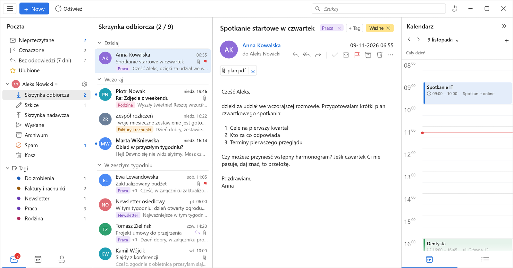
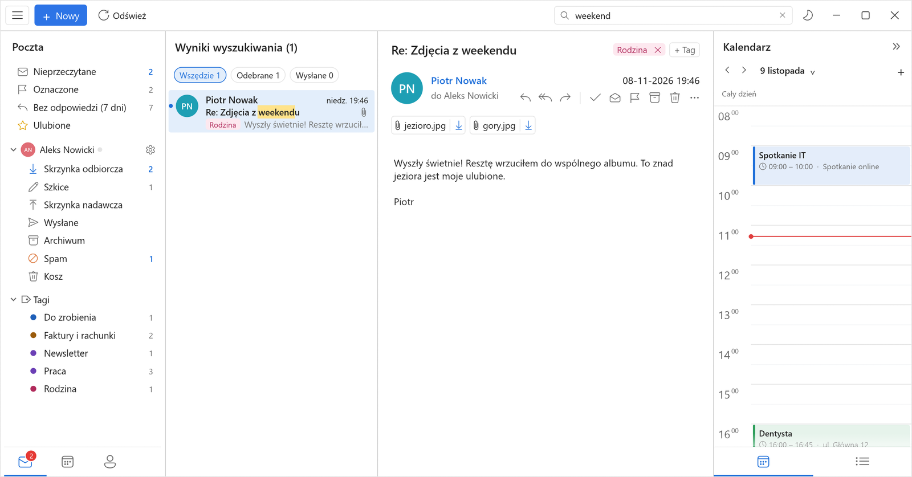
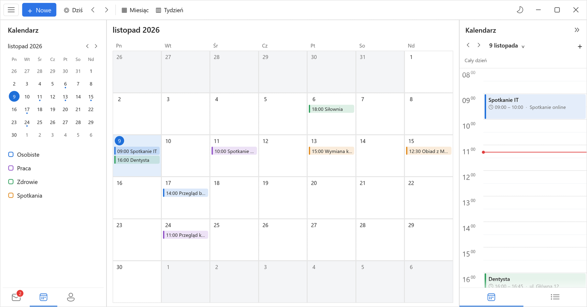
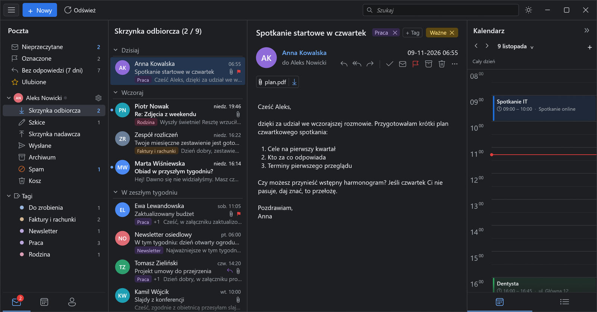
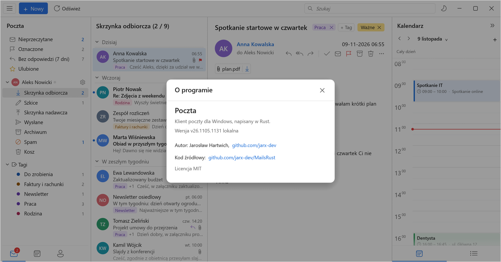

<div align="center">


# Poczta

**Szybki klient poczty dla Windows, napisany od zera w Rust.**

Poczta, kalendarz i kontakty w jednym oknie · start w ułamku sekundy · wyszukiwanie po słowach i po znaczeniu · AI pod ręką




<sub>Wszystkie zrzuty pokazują dane demonstracyjne (zmyślone osoby i wiadomości).</sub>

</div>

---

## Dlaczego

Popularne klienty poczty na Windows to dziś aplikacje webowe w opakowaniu: kilkaset megabajtów
pamięci, kilka sekund do pokazania skrzynki i interfejs, który ciągle na coś czeka. Poczta pokazuje,
że da się inaczej. To jeden plik EXE z natywnym interfejsem (egui) i lokalną bazą wiadomości.
Sieć, budowa indeksów i wszystko, co powolne, działa w wątkach w tle, więc interfejs nie czeka.

## Co potrafi

**Poczta**
- Gmail z logowaniem przez Google (OAuth) albo dowolna skrzynka IMAP/SMTP, także kilka kont naraz.
- Nowa poczta od razu (IMAP IDLE), z dźwiękiem, licznikiem na ikonie, notką w rogu ekranu
  i pracą w tle z zasobnika systemowego.
- Rozmowy w jednym miejscu: otwarta wiadomość rozwinięta, wcześniejsze zwinięte w karty.
- Widoki „Nieprzeczytane”, „Oznaczone”, „Bez odpowiedzi (7 dni)”, tagi Gmaila i ulubione.
- Wiadomości HTML wyświetlane silnikiem Edge (WebView2), z zapasowym własnym widokiem.
- Pisanie w Markdownie z podglądem na żywo, wysyłane jako HTML. Obrazki w treści, a podpis
  pobierany z Twoich wysłanych wiadomości.

**Wyszukiwanie**
- Indeks słów budowany w tle, wyniki od najnowszych, szukane słowo podświetlone.
- Wyszukiwanie po znaczeniu: mały wielojęzyczny model językowy (Model2Vec) działa lokalnie
  i znajduje wiadomości o tym samym, nawet gdy użyto innych słów.



**Kalendarz i kontakty**
- Widok miesiąca i tygodnia, panel dnia obok poczty, wydarzenia z Kalendarza Google.
- Kontakty z grupami, także zebrane z korespondencji („Z poczty”).



**AI (opcjonalnie, własny klucz)**
- „Popraw z AI” w kilku stylach i tłumaczenie odebranych wiadomości na polski.
- Działa z API zgodnym z Anthropic Messages (`/v1/messages`). Adres i klucz ustawia się
  w menu ☰ → „Ustawienia AI”.
- „Kopiuj link dla AI”: pojedynczą wiadomość można udostępnić agentowi AI w swojej prywatnej sieci
  Tailscale. Agent czyta ją jako tekst lub JSON i może zostawić szkic odpowiedzi w Szkicach,
  a niczego nie wysyła sam.

**Wygląd**
- Jasny i ciemny motyw, jeden zestaw ikon (Segoe Fluent), układ jak w klasycznych klientach
  poczty: foldery | lista | wiadomość | dzień w kalendarzu.



## Wydajność

Zmierzone na laptopie ze skrzynką liczącą 78 tys. wiadomości (baza ~530 MB):

| | |
|---|---|
| Otwarcie bazy | 1–3 ms |
| Skrzynka gotowa od otwarcia okna | 50–63 ms |
| CPU w spoczynku | 0,0–0,8% rdzenia |
| Rozmiar programu | jeden plik EXE, ~30 MB |

Szczegóły i metoda pomiarów: [PERF.md](PERF.md).

## Pod maską

| Warstwa | Technologia |
|---|---|
| Interfejs | [egui](https://github.com/emilk/egui) / eframe 0.37 (natywne okno, bez przeglądarki) |
| Baza wiadomości | [redb](https://github.com/cberner/redb), jeden plik w `%LOCALAPPDATA%\Poczta` |
| Wiadomości HTML | WebView2 (Edge), opcjonalnie własny silnik [Blitz](https://github.com/DioxusLabs/blitz) |
| Wyszukiwanie po znaczeniu | Model2Vec (potion-multilingual), wektory liczone lokalnie |
| Hasła | szyfrowane kluczem konta Windows (DPAPI) |
| Aktualizacje | własny mechanizm z weryfikacją SHA-256 i powrotem do poprzedniej wersji |

## Budowanie

Na Windows:

```sh
cargo build --release
```

Na Linuksie, krzyżowo pod Windows (tak powstają wydania):

```sh
cargo install cargo-xwin
cargo xwin build --release --target x86_64-pc-windows-msvc
```

Gotowy plik: `target/x86_64-pc-windows-msvc/release/mailclient.exe`. Program działa na Windows 10 i 11.

Opcjonalne zmienne przy budowaniu (wpisywane do EXE):

| Zmienna | Do czego |
|---|---|
| `POCZTA_DEFAULT_UPDATE_URL` | adres `latest.json`, z którego program pobiera aktualizacje; bez niej aktualizacje są wyłączone |
| `POCZTA_DEFAULT_AI_URL` | domyślny adres usługi AI dla nowej instalacji |

Skrypty `scripts/publish.sh` i `scripts/auto-publish.sh` budują i publikują wydanie po każdym
scaleniu do `main`. Swoje ustawienia czytają z `~/.config/poczta/build.env`.

## Struktura

```
src/
  app/        interfejs: lista, czytanie, pisanie, panel boczny, ustawienia, okno
  db.rs       lokalna baza wiadomości (redb)
  net.rs      IMAP/SMTP, IDLE, logowanie przez Google
  search.rs   indeks słów;  semantic.rs / finder.rs  wyszukiwanie po znaczeniu
  calendar.rs widoki kalendarza;  gcal.rs / google.rs  synchronizacja z Google
  ai.rs       poprawianie i szkice z AI;  translate.rs  tłumaczenie
  update.rs   samodzielne aktualizacje;  notify.rs  powiadomienia i liczniki
```

## O autorze

Pocztę napisał **Jarosław Hartwich** ([github.com/jarx-dev](https://github.com/jarx-dev)).
To samo znajdziesz w programie: menu ☰ → „O programie”.



## Licencja

[MIT](LICENSE). Kod możesz używać, zmieniać i rozpowszechniać, także komercyjnie.
