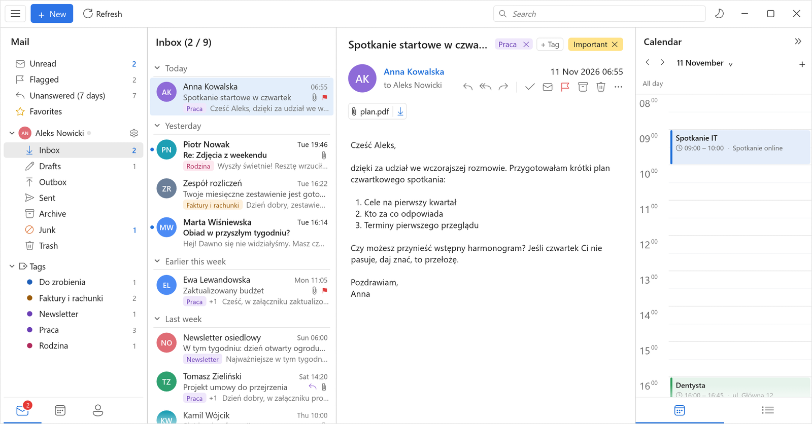
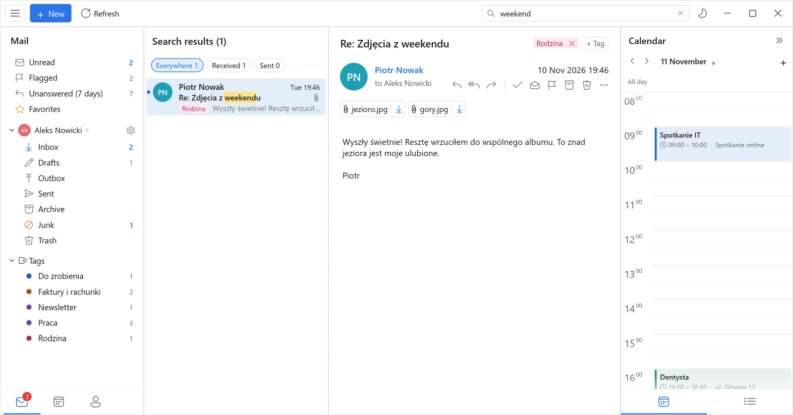
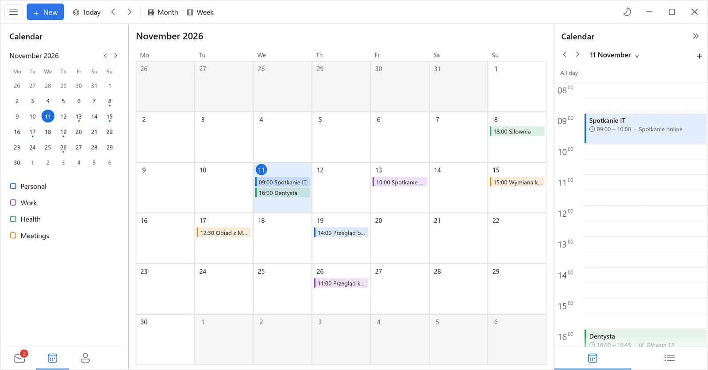
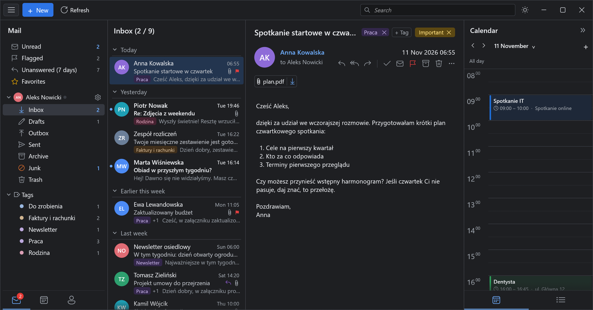
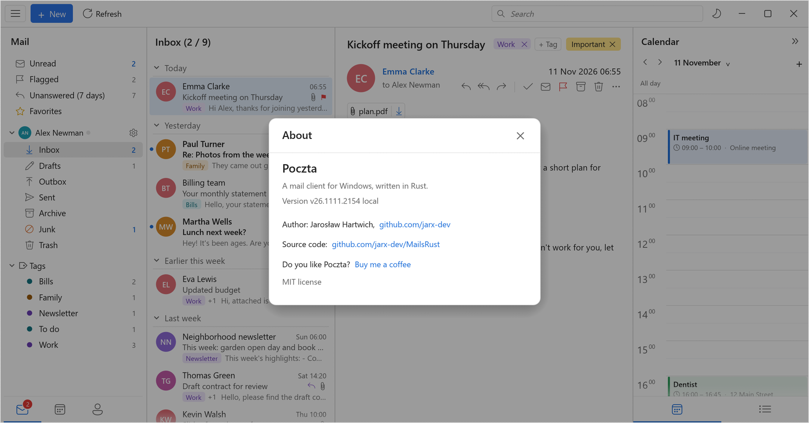

<div align="center">

<b>English</b> | <a href="README.pl.md">Polski</a>


# Poczta

**A fast email client for Windows, written from scratch in Rust.**

Mail, calendar and contacts in one window · starts in a fraction of a second · search by keyword and by meaning · AI at hand




<sub>All screenshots show demo data (made-up people and messages).</sub>

</div>

---

*"Poczta" is Polish for "Mail". The interface is in English or Polish (☰ menu → "Language / Język", switches at once).*

## Why

Today's popular email clients for Windows are web apps in a wrapper: hundreds of megabytes of
memory, several seconds to show your inbox, and an interface that is always waiting for something.
Poczta shows it can be done differently. It is a single EXE with a native interface (egui) and a
local message database. The network, index building and everything else that is slow run in
background threads, so the interface never waits.

## What it does

**Mail**
- Gmail with Google sign-in (OAuth) or any IMAP/SMTP mailbox, including several accounts at once.
- New mail arrives instantly (IMAP IDLE), with a sound, a counter on the icon, a notification
  in the corner of the screen and background operation from the system tray.
- Conversations in one place: the open message is expanded, earlier ones are collapsed into cards.
- Views for "Unread", "Flagged", "Unanswered (7 days)",
  Gmail labels and favorites.
- HTML messages rendered with the Edge engine (WebView2), with a built-in fallback renderer.
- Compose in Markdown with a live preview, sent as HTML. Inline images are supported, and your
  signature is taken from your sent messages.

**Search**
- A word index built in the background, results sorted newest first, the searched word highlighted.
- Search by meaning: a small multilingual language model (Model2Vec) runs locally and finds
  messages about the same thing, even when different words were used.



**Calendar and contacts**
- Month and week views, a day panel next to your mail, events from Google Calendar.
- Contacts with groups, including ones collected from your correspondence ("From mail").



**AI (optional, bring your own key)**
- "Fix with AI" in several styles, and translation of received messages into the interface language.
- Works with APIs compatible with the Anthropic Messages API (`/v1/messages`). The address and key are set
  in the ☰ menu → "AI settings".
- "Copy link for AI": a single message can be shared with an AI agent on your private
  Tailscale network. The agent reads it as text or JSON and can leave a draft reply in Drafts,
  but it never sends anything on its own. The page the agent reads is in Polish.

**Look and feel**
- Light and dark themes, a single icon set (Segoe Fluent), and a layout like classic mail
  clients: folders | list | message | calendar day.



## Performance

Measured on a laptop with a mailbox of 78 thousand messages (a ~530 MB database):

| | |
|---|---|
| Opening the database | 1–3 ms |
| Mailbox ready after the window opens | 50–63 ms |
| Idle CPU | 0.0–0.8% of one core |
| Program size | a single EXE file, ~30 MB |

Details and measurement method: [PERF.md](PERF.md).

## Under the hood

| Layer | Technology |
|---|---|
| Interface | [egui](https://github.com/emilk/egui) / eframe 0.37 (native window, no browser) |
| Message database | [redb](https://github.com/cberner/redb), a single file in `%LOCALAPPDATA%\Poczta` |
| HTML messages | WebView2 (Edge), optionally the custom [Blitz](https://github.com/DioxusLabs/blitz) engine |
| Search by meaning | Model2Vec (potion-multilingual), vectors computed locally |
| Passwords | encrypted with the Windows account key (DPAPI) |
| Updates | a built-in mechanism with SHA-256 verification and rollback to the previous version |

## Download

The ready-made EXE is on the [releases page](https://github.com/jarx-dev/MailsRust/releases/latest). Just
download and run it, no installation needed (Windows 10 or 11). The app downloads later releases by itself.
The file is not signed, so the first time Windows may warn about an unknown publisher:
"More info" → "Run anyway".

## Building

On Windows:

```sh
cargo build --release
```

On Linux, cross-compiling for Windows (this is how releases are built):

```sh
cargo install cargo-xwin
cargo xwin build --release --target x86_64-pc-windows-msvc
```

The resulting file: `target/x86_64-pc-windows-msvc/release/mailclient.exe`. The program runs on Windows 10 and 11.

Optional build-time variables (baked into the EXE):

| Variable | Purpose |
|---|---|
| `POCZTA_DEFAULT_UPDATE_URL` | URL of the `latest.json` file the program downloads updates from; without it, updates are disabled |
| `POCZTA_DEFAULT_AI_URL` | default AI service URL for a new installation |

The `scripts/publish.sh` and `scripts/auto-publish.sh` scripts build and publish a release after every
merge into `main`. They read their settings from `~/.config/poczta/build.env`.
GitHub releases are built by GitHub Actions (the "Wydanie" (Release) workflow, run manually from `main`):
the EXE, `latest.json` for updates and a build provenance attestation for the file. Every PR goes through
a build and tests on Windows (the "CI" workflow).

## Structure

```
src/
  app/        interface: list, reading, composing, side panel, settings, window
  db.rs       local message database (redb)
  net.rs      IMAP/SMTP, IDLE, Google sign-in
  search.rs   word index;  semantic.rs / finder.rs  search by meaning
  calendar.rs calendar views;  gcal.rs / google.rs  Google sync
  ai.rs       AI improvements and drafts;  translate.rs  translation
  update.rs   self-updates;  notify.rs  notifications and counters
```

## About the author

Poczta was written by **Jarosław Hartwich** ([github.com/jarx-dev](https://github.com/jarx-dev)).
You can find the same in the program: ☰ menu → "About".

If you find Poczta useful, you can [buy me a coffee](https://buymeacoffee.com/jarx) ☕



## License

[MIT](LICENSE). You may use, modify and redistribute the code, including commercially.
