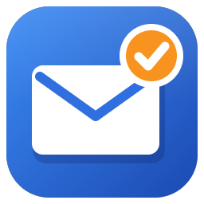
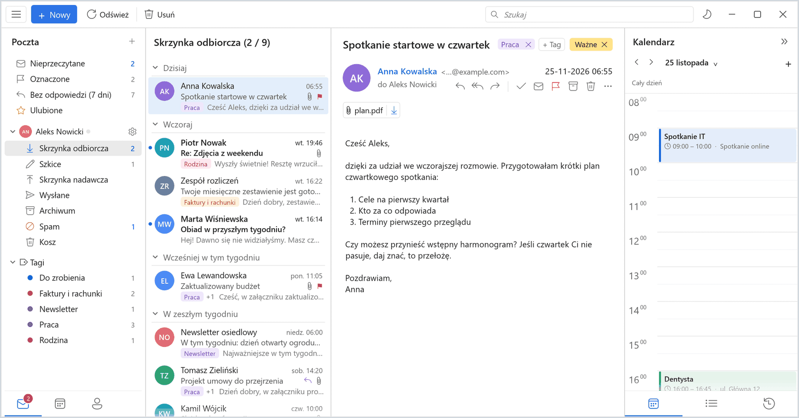
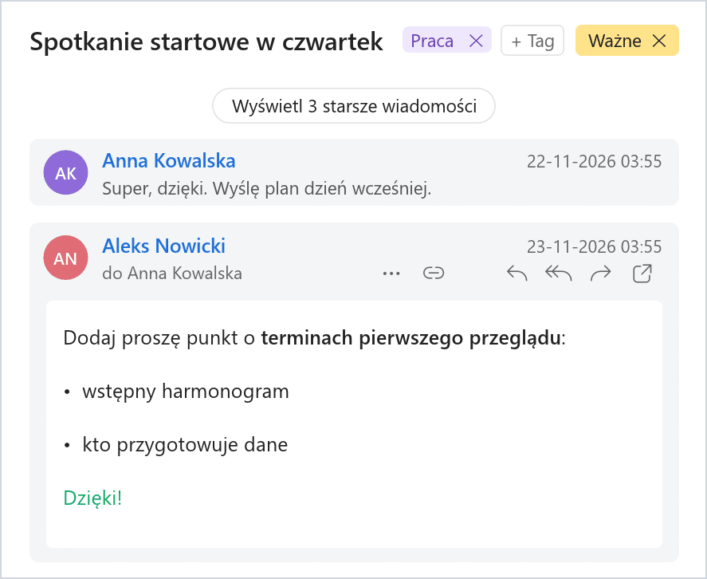
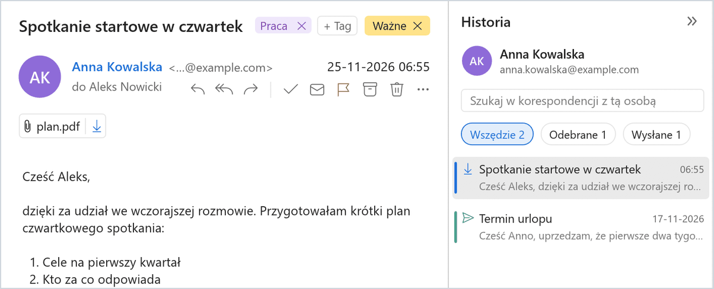
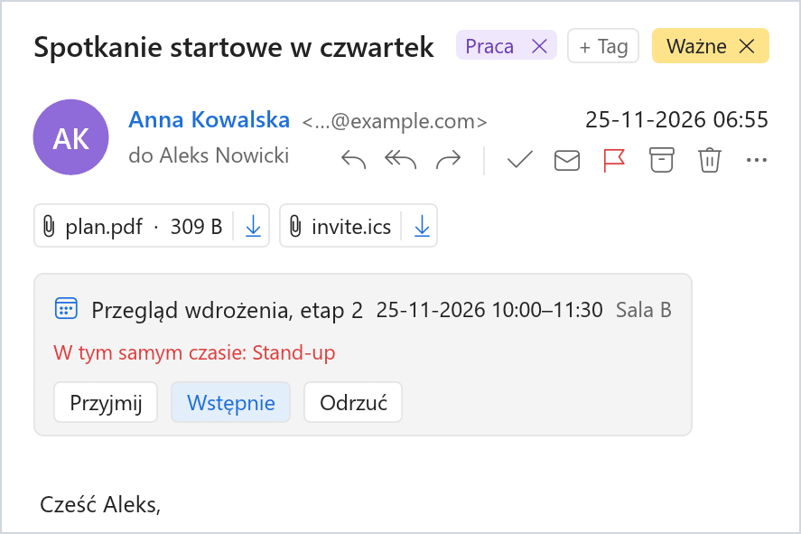
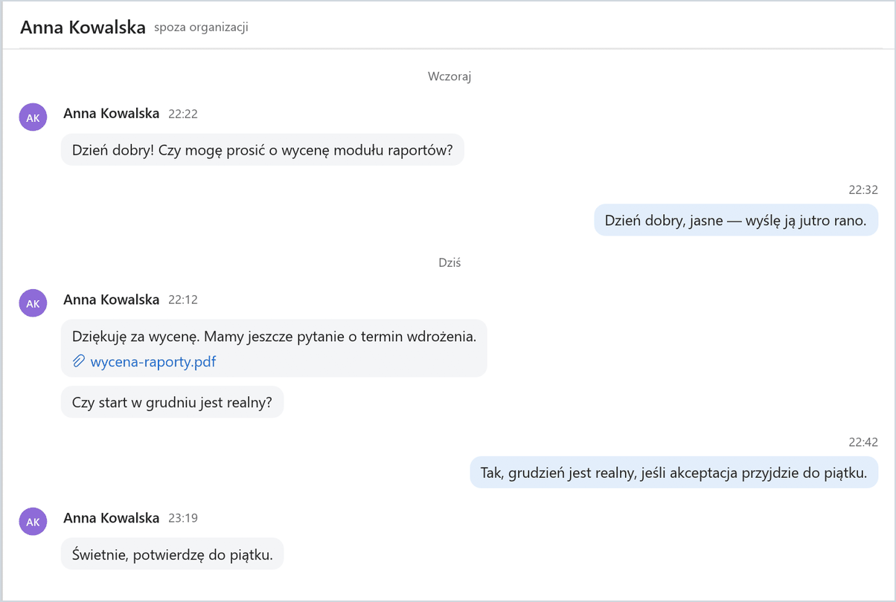
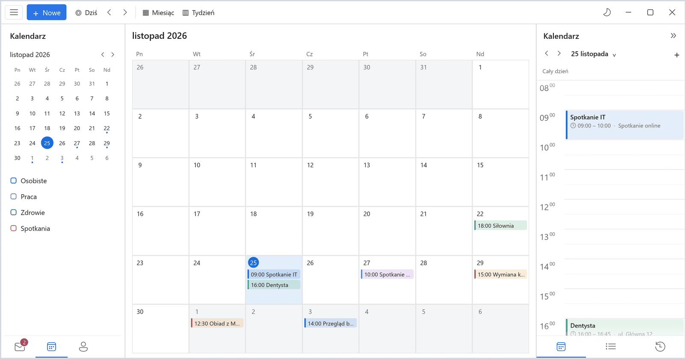
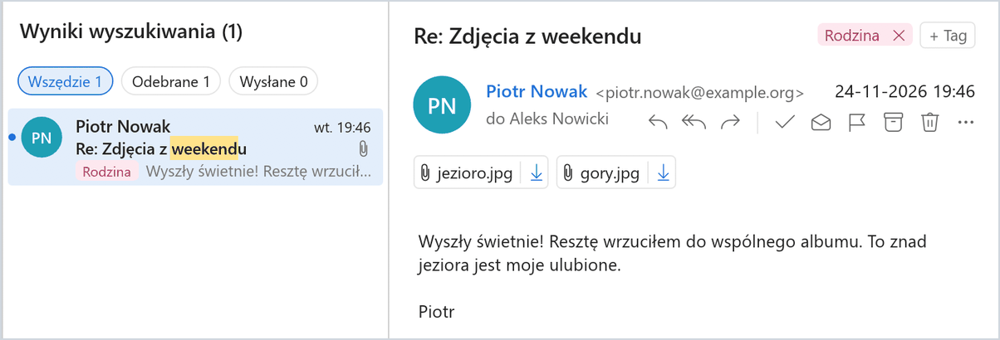

<div align="center">

<a href="README.md">English</a> | <b>Polski</b>



# Poczta

**Poczta, kalendarz i kontakty w jednym szybkim, natywnym programie dla Windows.**

Dla Gmaila i skrzynek IMAP, z wbudowanym Kalendarzem Google.<br>
**Poczta synchronizuje się prosto między Twoim dostawcą a Twoim komputerem, bez żadnego naszego serwera pośrodku.** Bez reklam, bez abonamentu. Darmowa i otwarta.

<a href="https://github.com/jarx-dev/MailsRust/releases/latest"></a>

<sub>Windows 10 i 11 · przenośny plik EXE, ok. 34 MB · bez podpisu cyfrowego · [pierwsze uruchomienie](#pobierz-i-uruchom)</sub>

[](https://github.com/jarx-dev/MailsRust/releases/latest)
[](https://github.com/jarx-dev/MailsRust/releases/latest)
[](https://github.com/jarx-dev/MailsRust/actions/workflows/ci.yml)
[](LICENSE)

[Poczta a Outlook](#poczta-a-nowy-outlook) · [Funkcje](#co-dostajesz) · [Pobierz](#pobierz-i-uruchom) · [Wydajność](#wydajność) · [Prywatność](#prywatność-w-skrócie) · [Dla programistów](#dla-programistów)

<picture>
  <source media="(prefers-color-scheme: dark)" srcset="docs/screenshots/dark.png">
  
</picture>

<sub>Wszystkie zrzuty pokazują dane demonstracyjne (zmyślone osoby i wiadomości). Program mówi po polsku i po angielsku.</sub>

</div>

## Poczta a nowy Outlook

Myślisz o rozstaniu z nowym Outlookiem dla Windows? Oto co się zmienia. Każde zdanie o tym, jak działa
Outlook, prowadzi do dokumentacji Microsoftu.

| | **Poczta** | **Nowy Outlook dla Windows** |
|---|---|---|
| **Konta** | Gmail i skrzynki IMAP/SMTP. Jeszcze nie: logowanie Microsoftu do Outlook.com, Microsoft 365 i Exchange | Outlook.com, Microsoft 365, Exchange, Gmail, Yahoo, iCloud i inne ([Microsoft](https://support.microsoft.com/pl-pl/outlook/getstarted/add-an-email-account-to-outlook-for-windows)) |
| **Dokąd trafia kopia Twojego Gmaila** | Na Twój komputer | Dla wielu funkcji także do chmury Microsoftu: poczta, kalendarz i kontakty ([Microsoft](https://support.microsoft.com/pl-pl/outlook/getstarted/sync-your-account-in-outlook-to-the-microsoft-cloud)) |
| **Reklamy** | Żadnych i żadnych identyfikatorów reklamowych | Z bezpłatnym kontem osobistym pokazuje reklamy w skrzynce i przekazuje sieciom reklamowym cookie lub identyfikator urządzenia; bez reklam tylko z subskrypcją Microsoft 365 ([Microsoft](https://support.microsoft.com/pl-pl/outlook/about-ads-in-outlook)) |
| **Cena** | Za darmo, licencja MIT | Za darmo z reklamami albo subskrypcja Microsoft 365 ([Microsoft](https://support.microsoft.com/pl-pl/outlook/about-ads-in-outlook)) |

Poczta nie ma jeszcze logowania przez Microsoft, którego wymagają konta Outlook.com, Microsoft 365
i Exchange; działa jedynie firmowy serwer Exchange, który przyjmuje hasło przez IMAP. Nie ma wersji na macOS, Linuksa ani telefon.

## Co dostajesz

**Szybka, także z dużą skrzynką.** Lista wiadomości jest odczytana z dysku w ok. 60 ms, skrzynka z 78 tysiącami
wiadomości jest na ekranie w niecałą sekundę, a w spoczynku zmierzone zużycie to 0,0–0,8% jednego rdzenia,
więc program siedzi cicho w tle. Synchronizacja i indeksowanie idą w wątkach w tle, więc przewijanie
i czytanie nie czekają na sieć ([pomiary](#wydajność)).

### Rozmowy i historia
Zawsze wiesz, kto co napisał.
- **Rozmowy w jednym miejscu:** otwarta wiadomość rozwinięta, wcześniejsze zwinięte w karty.
- **Historia** przy każdej wiadomości: poczta od tej osoby i ta, którą wysłałeś wprost do niej, jedno kliknięcie dalej.
- **Nowa poczta, gdy tylko serwer da sygnał** (IMAP IDLE), z dźwiękiem, licznikiem na ikonie
  i powiadomieniem, także gdy Poczta siedzi w zasobniku.
- **Porządek po Twojemu:** widoki „Nieprzeczytane”, „Oznaczone” i „Bez odpowiedzi (7 dni)”, a w Gmailu też tagi,
  ulubione i własne foldery, na które przeciąga się wiadomości. Filtry Gmaila tworzy się i zmienia w programie.
- Kilka kont naraz: główne z logowaniem przez Google albo hasłem, kolejne z hasłem (dla Gmaila hasło aplikacji).

<table>
<tr>
<td width="50%" valign="top"><picture><source media="(prefers-color-scheme: dark)" srcset="docs/screenshots/thread-dark.png"></picture></td>
<td width="50%" valign="top"><picture><source media="(prefers-color-scheme: dark)" srcset="docs/screenshots/history-dark.png"></picture></td>
</tr>
<tr>
<td align="center"><sub>Rozmowa, wcześniejsze wiadomości zwinięte</sub></td>
<td align="center"><sub>Historia: Twoja poczta z tą osobą</sub></td>
</tr>
</table>

### Pisanie, które nadąża
Formatujesz w trakcie pisania, bez sięgania po pasek narzędzi.
- **Markdown podczas pisania:** `**pogrubienie**`, `*kursywa*`, `` `kod` ``, listy i nagłówki od razu
  zamieniają się w formatowanie, a wiadomość wychodzi jako zwykły HTML.
- **@wzmianki:** wpisz **@** i imię, żeby wybrać osobę z książki adresowej; trafia od razu do „Do”.
- Obrazki w treści, a podpis pobierany z wiadomości, które już wysłałeś.

### Zaproszenia, kalendarz i czat Google
Twój dzień obok poczty, więc na zaproszenie odpowiadasz, wiedząc, z czym koliduje.
- **Zaproszenia** mają Przyjmij · Wstępnie · Odrzuć tuż nad wiadomością, z informacją, z czym spotkanie
  koliduje. 10 minut przed każdym spotkaniem o określonej godzinie pojawia się przypomnienie.
- **Kalendarz** w widoku miesiąca i tygodnia oraz panel dnia obok poczty, synchronizowane z Kalendarzem
  Google w obie strony.
- **Czat Google** dla kont Google Workspace, w tym samym oknie.
- **Kontakty** z grupami, także osoby, z którymi korespondujesz.

<table>
<tr>
<td width="50%" valign="top"><picture><source media="(prefers-color-scheme: dark)" srcset="docs/screenshots/invite-dark.png"></picture></td>
<td width="50%" valign="top"><picture><source media="(prefers-color-scheme: dark)" srcset="docs/screenshots/chat-dark.png"></picture></td>
</tr>
<tr>
<td align="center"><sub>Odpowiedz na zaproszenie, zobacz kolizje</sub></td>
<td align="center"><sub>Czat Google w tym samym oknie</sub></td>
</tr>
</table>

<picture>
  <source media="(prefers-color-scheme: dark)" srcset="docs/screenshots/calendar-dark.png">
  
</picture>

### Znajdziesz wszystko
- **Wyszukiwanie słów** z indeksu budowanego w tle: od najnowszych, szukane słowo podświetlone.
- **Wyszukiwanie po znaczeniu:** wielojęzyczny model działa na Twoim komputerze i znajduje
  wiadomości o tym samym, nawet gdy użyto innych słów. Model (ok. 500 MB) pobiera się raz, przy pierwszym
  uruchomieniu z kontem pocztowym; potem to wyszukiwanie działa bez sieci i nigdzie nie wysyła ani poczty,
  ani tego, czego szukasz.

<picture>
  <source media="(prefers-color-scheme: dark)" srcset="docs/screenshots/search-dark.png">
  
</picture>

### Bezpieczna od początku
- Wiadomości nie uruchamiają własnych skryptów, a link, którego tekst pokazuje jeden adres, a otwiera inną stronę, jest oznaczony.
- Nad wiadomością, która wygląda na phishing, pojawia się ostrzeżenie. Te sprawdzenia działają na Twoim
  komputerze; druga opinia AI jest o jedno kliknięcie, gdy masz ustawione AI.

### AI na Twoich warunkach (opcjonalnie)
- **Popraw z AI** w kilku stylach i **tłumaczenie** odebranych wiadomości na Twój język.
- Działa z każdym API zgodnym z Anthropic Messages (`/v1/messages`), z Twoim adresem i kluczem
  (menu ☰ → „Ustawienia AI”). Te funkcje są wyłączone, dopóki ich nie podasz, i działają tylko po kliknięciu.

### Dobrze wygląda
Jasny i ciemny motyw, jeden zestaw ikon (Segoe Fluent), polski albo angielski (menu ☰ → „Language / Język”,
zmiana od razu) i klasyczny układ: foldery | lista | wiadomość | dzień w kalendarzu.

## Pobierz i uruchom

<a href="https://github.com/jarx-dev/MailsRust/releases/latest"></a>

1. **Pobierz** `Poczta-….exe` z listy **Assets** na [stronie wydania](https://github.com/jarx-dev/MailsRust/releases/latest)
   (przycisk otwiera tę stronę).
2. **Sprawdź, jeśli chcesz.** Plik nie jest podpisany, ale każde wydanie na GitHubie buduje GitHub Actions z tego
   repozytorium, z atestacją pochodzenia: `gh attestation verify Poczta-….exe -R jarx-dev/MailsRust`.
3. **Uruchom.** Nie trzeba niczego instalować. Windows SmartScreen może ostrzec przed nieznanym wydawcą:
   „Więcej informacji” → „Uruchom mimo to”.
4. **Dodaj konto**: Gmail z logowaniem przez Google albo skrzynka IMAP/SMTP. Pierwsze logowanie przez
   Google wymaga jednorazowej konfiguracji własnego projektu w Google Cloud (ok. 5 minut, program
   prowadzi krok po kroku); dopóki projekt jest w trybie testowym, Google prosi o ponowne logowanie co 7 dni.
   Hasło aplikacji Gmaila przez IMAP to wszystko pomija. Poczta zostaje
   na serwerze jak dotąd; program trzyma własną kopię w `%LOCALAPPDATA%\Poczta`. Przy tym pierwszym
   uruchomieniu pobiera też raz model do wyszukiwania po znaczeniu (ok. 500 MB).

Kolejne wydania program pobiera sam, sprawdza ich SHA-256 i wraca do poprzedniej wersji, jeśli nowa
się nie uruchomi.

## Pomoc

Program nie startuje, nie da się dodać konta albo brakuje Ci jakiejś funkcji?
[Zgłoś to](https://github.com/jarx-dev/MailsRust/issues) i opisz, co widzisz.

## Wydajność

Zmierzone na laptopie z dyskiem NVMe i prawdziwą skrzynką liczącą 78 507 wiadomości (baza ~530 MB).
Czasy liczone od otwarcia okna.

| Co | Wynik |
|---|---|
| Otwarcie bazy | 1–3 ms |
| Lista wiadomości odczytana z dysku | 50–63 ms |
| Pierwsza klatka z całą skrzynką | 0,7–0,8 s |
| CPU w spoczynku | 0,0–0,8% rdzenia |
| Pamięć w spoczynku, z tą skrzynką i jej indeksem wyszukiwania | 385–392 MB |
| Program | jeden plik EXE, ok. 34 MB |

Szczegóły i metoda pomiarów: [PERF.md](PERF.md).

## Prywatność w skrócie

**Twoja poczta nie przechodzi przez żaden nasz serwer: Poczta synchronizuje się bezpośrednio z Twoim dostawcą poczty.
Poczta trafia do usługi AI tylko wtedy, gdy sam ją ustawisz i klikniesz funkcję AI albo włączysz agentów AI (niżej).**

- Twoja kopia poczty zostaje na Twoim komputerze: baza i folder cache w `%LOCALAPPDATA%\Poczta`. Hasła są szyfrowane kluczem Twojego konta Windows (DPAPI).
- Poczta nie ma analityki ani śledzenia. Wszystko, z czym się łączy:
  - Twój serwer poczty oraz Google przy logowaniu, Gmailu, Kalendarzu, Kontaktach i Czacie;
  - serwery, na których leżą obrazki i style w otwieranej wiadomości (Poczta otwiera najnowszą
    przy starcie), więc jak w większości programów pocztowych nadawca może poznać, że ją otwarto;
  - adresy, które sam dodasz: kalendarze iCal i link autorespondera;
  - strona, której link wkleisz do pisanej wiadomości, żeby pobrać jej tytuł;
  - publiczna usługa ikon stron Google, żeby pokazać logo firm, które do Ciebie piszą (widzi ich domenę);
  - Hugging Face, raz, żeby pobrać model do wyszukiwania po znaczeniu;
  - GitHub, żeby sprawdzić i pobrać nowe wydania;
  - errors.jarx.pl, żeby wysłać krótki raport o awarii, który można wyłączyć ([dokładnie to, co zawiera](#raporty-o-awariach));
  - usługa AI, którą sam ustawisz, jeśli w ogóle: tylko to, czego potrzebuje kliknięta funkcja, np. tekst
    do poprawy albo tłumaczenia, a przy sprawdzaniu phishingu sama wiadomość: temat, tekst, nadawca, nagłówki, linki i nazwy załączników.

## Raporty o awariach

Gdy w programie wystąpi panika (w Ruście), wysyła on jeden krótki, anonimowy raport, żeby błąd dało
się znaleźć i poprawić. Zgłaszana jest tylko pierwsza panika w danym uruchomieniu, także taka, po
której program działa dalej (część zadań w tle przechwytuje paniki). Domyślnie jest to włączone;
wyłączysz w menu ☰: **Wysyłaj raporty o awariach**. Zmiana działa od razu. Wersje zbudowane
`cargo build` w trybie debug nigdy nic nie wysyłają.

Tak wygląda cały raport, trzy linie koperty Sentry:

```
{"event_id":"4f0c1d0e9a2b4c7d8e6f5a4b3c2d1e0f"}
{"type":"event"}
{"event_id":"4f0c1d0e9a2b4c7d8e6f5a4b3c2d1e0f","level":"fatal","platform":"native","release":"poczta@26.1104.2135","environment":"production","contexts":{"os":{"name":"Windows","version":"10.0.26100"}},"exception":{"values":[{"type":"panic","value":"src/app/list.rs:123","mechanism":{"type":"panic","handled":false}}]},"fingerprint":["src/app/list.rs:123"]}
```

Czyli: numer kompilacji (kiedy program zbudowano, w UTC), wersja Windows i miejsce w kodzie
źródłowym, w którym się wywrócił. `event_id` to losowy numer tego jednego raportu. Ścieżka miejsca jest
skracana tak, żeby nie wyszedł żaden katalog komputera, na którym program zbudowano: pliki tego
repozytorium zostają bez zmian (`src/app/list.rs`), biblioteka z rejestru cargo od katalogu crate'a
(`ureq-2.12.1/src/pool.rs`), biblioteka standardowa od `library/` (`core/src/option.rs`), a każda
inna ścieżka to sama nazwa pliku. Żądanie ma też nagłówki `User-Agent` i `X-Sentry-Auth` z nazwą i wersją programu
oraz publicznym kluczem projektu, nic więcej.

Nigdy nie jest wysyłane: treść komunikatu paniki (bywa w niej adres, temat albo fragment wiadomości),
nazwy ani ścieżki Twoich plików, nazwa komputera i użytkownika, adresy e-mail, treść poczty, nazwy kont,
ustawienia, logi, zmienne środowiska, żaden identyfikator instalacji ani użytkownika; nie ma też śledzenia sesji.

Raporty trafiają na własny serwer autora [Rustrak](https://github.com/rustrak/rustrak) (open source,
zgodny z Sentry) pod errors.jarx.pl, nie do żadnej firmy zbierającej błędy. Jak każda strona za
Cloudflare, ruch przechodzi przez Cloudflare. Sam raport nie zawiera adresu IP, ale serwer, jak każdy
serwer WWW, widzi IP połączenia w logu dostępu.

Kod jest krótki i można go sprawdzić w [src/crash_report.rs](src/crash_report.rs).

## Dla programistów

### Pod maską

| Warstwa | Technologia |
|---|---|
| Interfejs | [egui](https://github.com/emilk/egui) / eframe 0.37: natywne okno, nie Electron |
| Wiadomości HTML i edytor | WebView2 (Edge), dla wiadomości opcjonalnie otwarty silnik [Blitz](https://github.com/DioxusLabs/blitz) |
| Baza wiadomości | [redb](https://github.com/cberner/redb), jeden plik w `%LOCALAPPDATA%\Poczta` |
| Wyszukiwanie po znaczeniu | Model2Vec (potion-multilingual), wektory liczone lokalnie |
| Hasła | szyfrowane kluczem konta Windows (DPAPI) |
| Aktualizacje | własny mechanizm z weryfikacją SHA-256 i powrotem do poprzedniej wersji |

### Agenci AI (MCP)

Agenci AI w Twojej prywatnej sieci Tailscale (Claude Code, Codex) mogą przeszukiwać pocztę po słowach i znaczeniu (wyniki to same nagłówki),
czytać wiadomości, o które poproszą, i zostawiać szkice odpowiedzi. Niczego nie wysyłają: każdy szkic
sprawdzasz i wysyłasz sam. Domyślnie wyłączone (menu ☰ → „Ustawienia AI” → „Agenci AI (MCP)”).

### Budowanie

Na Windows:

```sh
cargo build --release
```

Na Linuksie, krzyżowo pod Windows (tak powstają wydania):

```sh
cargo install cargo-xwin
cargo xwin build --release --target x86_64-pc-windows-msvc
```

Gotowy plik: `target/x86_64-pc-windows-msvc/release/mailclient.exe`. Program działa na Windows 10 i 11.

Opcjonalne zmienne przy budowaniu (wpisywane do EXE):

| Zmienna | Do czego |
|---|---|
| `POCZTA_DEFAULT_UPDATE_URL` | adres `latest.json`, z którego program pobiera aktualizacje; bez niej aktualizacje są wyłączone |
| `POCZTA_DEFAULT_AI_URL` | domyślny adres usługi AI dla nowej instalacji |

### Tłumaczenia

Wszystkie teksty interfejsu są w `locales/*.en.yml` i `locales/*.pl.yml`. Nowy język to jeden komplet
takich plików; pull requesty mile widziane.

<details>
<summary><b>Wydania i układ kodu</b></summary>

Skrypty `scripts/publish.sh` i `scripts/auto-publish.sh` budują i publikują wydanie po każdym
scaleniu do `main`. Swoje ustawienia czytają z `~/.config/poczta/build.env`.
Wydania na GitHubie buduje GitHub Actions (workflow „Wydanie”, uruchamiany ręcznie z `main`):
EXE, `latest.json` dla aktualizacji i atestacja pochodzenia pliku. Każdy PR przechodzi build
i testy na Windows (workflow „CI”).

```
src/
  app/        interfejs: lista, czytanie, pisanie, panel boczny, ustawienia, okno
  db.rs       lokalna baza wiadomości (redb)
  net.rs      IMAP/SMTP, IDLE, logowanie przez Google
  search.rs   indeks słów;  semantic.rs / finder.rs  wyszukiwanie po znaczeniu
  calendar.rs widoki kalendarza;  gcal.rs / google.rs  synchronizacja z Google
  ai.rs       poprawianie i szkice z AI;  translate.rs  tłumaczenie
  update.rs   samodzielne aktualizacje;  notify.rs  powiadomienia i liczniki
```

</details>

## O autorze

Pocztę napisał **Jarosław Hartwich** ([github.com/jarx-dev](https://github.com/jarx-dev)).
To samo znajdziesz w programie: menu ☰ → „O programie”.

Jeśli Poczta Ci się przydaje, możesz [postawić mi kawę](https://buymeacoffee.com/jarx) ☕

## Licencja

[MIT](LICENSE). Kod możesz używać, zmieniać i rozpowszechniać, także komercyjnie.
